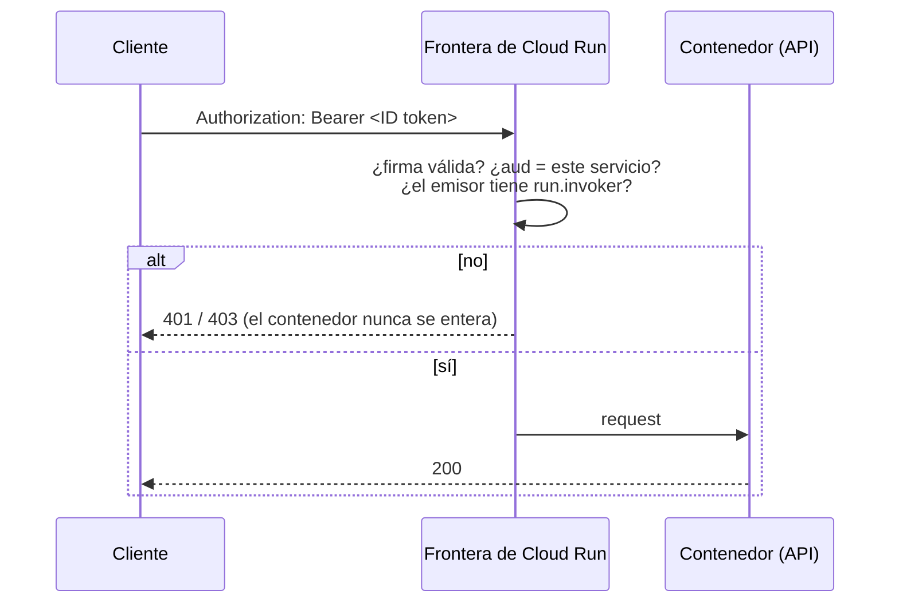
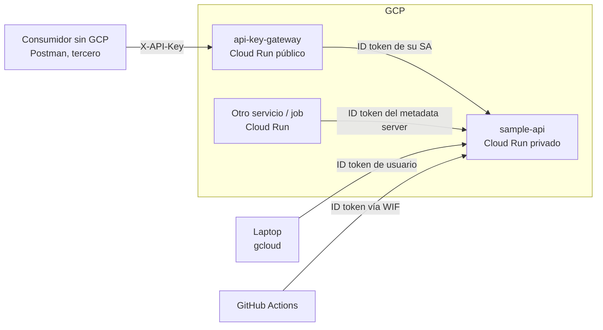

# cloudrun-private-auth: Arquitectura

Cómo exponer y consumir **APIs privadas en Cloud Run** sin escribir código de autenticación en la API. Incluye:

1. Una **API de ejemplo** desplegada en privado.
2. Un **cliente reutilizable** que obtiene ID tokens y los refresca solo, en cualquier entorno.
3. Un **gateway con API key** para consumidores sin identidad en GCP.
4. Un **workflow de GitHub Actions** que llama a la API privada sin llaves JSON (Workload Identity Federation).

## 1. La idea central: quién protege qué

> **La protección es el IAM de Cloud Run. El ID token es solo la credencial con la que el cliente demuestra quién es.**

La API **no tiene ni una línea de autenticación**. Se despliega sin `--allow-unauthenticated` y solo quien tiene `roles/run.invoker` puede llamarla. Cloud Run rechaza todo lo demás en su frontera, **antes de que llegue al contenedor**.



## 2. Componentes



| Componente | Qué es | Expuesto |
|---|---|---|
| `sample-api/` | FastAPI mínima: `/health` y `/whoami` | Privado (IAM) |
| `client/` | Módulo `identity_token.py`: `get_session(url)` y `get_token(url)` | Librería |
| `gateway/` | Recibe una API key y reenvía con ID token a rutas permitidas | Público |
| `.github/workflows/call-private-api.yml` | Llama a la API privada desde CI | — |
| `deploy/` | Scripts `gcloud` para desplegar y dar permisos | — |

## 3. `sample-api`

| Ruta | Respuesta |
|---|---|
| `GET /health` | `{"status": "ok"}` |
| `GET /whoami` | `{"email": "...", "aud": "..."}`: quién llamó, según el token |

`/whoami` existe para la demo: hace visible que cada camino llega con una identidad distinta (usuario, SA del servicio, SA de CI, SA del gateway). Decodifica el JWT **sin verificar la firma**, lo cual es aceptable **solo porque Cloud Run ya lo verificó en la frontera**. El código lo dice en un comentario y el README advierte que no se copie a una API pública.

## 4. Cliente: `identity_token.py`

Un solo módulo, copiable o instalable con `pip install git+...`. Resuelve la credencial en este orden, sin que el código que lo usa tenga que distinguir el entorno:

| # | Dónde corre | Configuración | Credencial | ¿Se refresca? |
|---|---|---|---|---|
| 1 | Laptop | `GCP_ID_TOKEN` | Token ya emitido con `gcloud auth print-identity-token` | No, dura ~1 h |
| 2 | Fuera de GCP (on-prem, n8n) | `GOOGLE_APPLICATION_CREDENTIALS` | Llave JSON de una SA | Sí |
| 3 | Dentro de GCP (Cloud Run, GCE, Functions, CI con WIF) | nada | Metadata server o ADC | Sí |

```python
from identity_token import get_session

API = "https://sample-api-xxxx.run.app"
session = get_session(API)            # adjunta el token y lo renueva al expirar
session.get(f"{API}/whoami").json()
```

**Errores frecuentes que el módulo y el README previenen:**

| Error | Síntoma | Cómo se evita |
|---|---|---|
| Usar access token en vez de ID token | `401` | `get_token()` solo emite ID tokens |
| `aud` de otro servicio | `401` | El audience se normaliza a la URL base `https://` del servicio; cualquier otra cosa lanza `ValueError` |
| `--audiences` con cuenta de usuario | `gcloud` falla con *Requires valid service account* | Documentado: con usuario se usa `print-identity-token` sin flags |
| Token pre-emitido caducado | `401` tras ~1 h | Documentado; en procesos largos usar 2 o 3 |

## 5. Gateway con API key

**Cuándo usarlo:** consumidores sin identidad en GCP, como testers con Postman, un tercero o una herramienta no-code. **No** es para usuarios finales de un producto: para eso está Identity Platform o Firebase Auth (ver §7).

**Flujo**

1. Valida `X-API-Key` contra los hashes configurados.
2. Comprueba que el método y la ruta estén en la **lista permitida**. Si no, responde `404`.
3. **Descarta** el `Authorization` que mande el cliente.
4. Obtiene un ID token con su propia SA (reutiliza `client/identity_token.py`).
5. Reenvía cuerpo, query y `X-Request-Id` a la API privada con timeout, y devuelve la respuesta tal cual.

**Configuración** (variables de entorno, valores sensibles desde Secret Manager)

| Variable | Ejemplo | Uso |
|---|---|---|
| `UPSTREAM_URL` | `https://sample-api-xxxx.run.app` | API privada (también es el audience) |
| `API_KEYS` | `testers:<sha256>,partner-a:<sha256>` | Consumidor → hash SHA-256 de su key |
| `ALLOWED_ROUTES` | `GET /health,GET /whoami` | Rutas que se pueden reenviar |
| `UPSTREAM_TIMEOUT_SECONDS` | `10` | Timeout hacia la API |

**Respuestas propias del gateway**

| Código | Cuándo |
|---|---|
| `401` | Falta la key o es inválida |
| `404` | La ruta no está en la lista permitida |
| `502` | La API privada respondió `401/403`: falta `run.invoker` a la SA del gateway |
| `504` | Timeout hacia la API |

**Decisiones**

| Decisión | Motivo |
|---|---|
| Se guardan **hashes** de las keys, no las keys | Si se filtra la configuración, las keys no quedan expuestas |
| Comparación con `hmac.compare_digest` | Tiempo constante: no filtra información por timing |
| Una key **por consumidor**, con nombre | Se revoca una sin afectar a las demás y el log registra quién llamó (nunca la key) |
| **Lista permitida** de rutas | El gateway no convierte toda la API privada en pública |
| Se descarta el `Authorization` del cliente | El cliente no puede inyectar su propio token hacia la API |
| `requests` + `AuthorizedSession` vía `run_in_threadpool` | Reutiliza el cliente del repo sin bloquear el loop; el body (máx. 1 MiB) se lee solo tras validar key y ruta |
| Sin rate limiting propio | Fuera de alcance; si hace falta, va en API Gateway o Cloud Armor, no en código. `--max-instances` (`GATEWAY_MAX_INSTANCES`, 3 por defecto) acota el costo de un abuso |

> **Nota:** si la organización tiene la política *Domain Restricted Sharing*, `allUsers` no se puede asignar y el gateway no puede ser público. En ese caso la alternativa es **API Gateway** con API keys administradas.

## 6. CI sin llaves: Workload Identity Federation

`.github/workflows/call-private-api.yml`:

1. `google-github-actions/auth` intercambia el token OIDC de GitHub por credenciales de una SA. **No hay llave JSON en los secretos.**
2. Un paso de Python con `get_token(API)` llama a `/whoami` y verifica `200` y el email de la SA esperada.

`deploy/setup-wif.sh` crea el pool, el provider (restringido por `repository_id` a este repo y a la rama `main`), la SA y su `run.invoker`.

## 7. Cuándo usar qué

| Consumidor | Método |
|---|---|
| Servicio o job en GCP | ID token del metadata server (cliente, camino 3) |
| CI en GitHub | WIF + ID token (§6) |
| Desarrollador del equipo | `gcloud auth print-identity-token` (camino 1) |
| Tercero o tester sin GCP | Gateway con API key (§5) o API Gateway |
| Usuarios finales de una app | Identity Platform / Firebase Auth. **No** este repo |
| Apps web internas con login | IAP |

## 8. Estructura del repo

```text
cloudrun-private-auth/
├── sample-api/
│   ├── main.py
│   ├── Dockerfile
│   └── requirements.txt
├── client/
│   ├── identity_token.py
│   └── test_identity_token.py
├── gateway/
│   ├── app/
│   │   ├── main.py        # rutas y reenvío
│   │   ├── auth.py        # validación de API key
│   │   └── config.py      # parseo de variables de entorno
│   ├── tests/
│   ├── Dockerfile
│   └── requirements.txt
├── deploy/
│   ├── env.example        # PROJECT_ID, REGION, nombres de servicio
│   ├── deploy-sample-api.sh
│   ├── deploy-gateway.sh
│   ├── setup-wif.sh
│   └── verify.sh          # comprueba que la API responde 403 sin token
├── .github/workflows/
│   ├── ci.yml             # ruff + pytest
│   └── call-private-api.yml
├── ARQUITECTURA.md
└── README.md
```

Todos los scripts toman `PROJECT_ID` y `REGION` de `deploy/env`. **No hay IDs reales en el repo.**

## 9. Stack

| Pieza | Elección |
|---|---|
| Lenguaje | Python 3.12 |
| API y gateway | FastAPI + Uvicorn |
| Auth del lado cliente | `google-auth`, `requests` |
| Infra | Cloud Run, IAM, Secret Manager, Workload Identity Federation |
| Calidad | ruff, pytest; CI en GitHub Actions |
| Contenedores | `python:3.12-slim`, usuario sin privilegios |

## 10. Pruebas

Todas corren **sin GCP** (credenciales y API privada simuladas):

- **Cliente:** orden de resolución (`GCP_ID_TOKEN` > llave JSON > metadata) y `ValueError` con un audience que no sea una URL `https://`.
- **Gateway:**
  - sin key o key inválida → `401`
  - ruta no permitida → `404`
  - el `Authorization` del cliente se reemplaza por el token del gateway
  - API responde `403` → `502`
  - timeout → `504`
  - la key nunca aparece en logs
- **Contra GCP real** (manual, `deploy/verify.sh`): `403` sin token y `200` con token.

## 11. Plan de trabajo (~1 día)

| # | Commit | Contenido |
|---|---|---|
| 1 | `feat: private sample api` | `sample-api/` + `deploy-sample-api.sh` + `verify.sh` |
| 2 | `feat: identity token client` | `client/` + pruebas |
| 3 | `feat: api key gateway` | `gateway/` + pruebas + `deploy-gateway.sh` |
| 4 | `ci: lint and tests` | `ci.yml` |
| 5 | `feat: keyless ci with workload identity federation` | `setup-wif.sh` + `call-private-api.yml` |
| 6 | `docs: readme with diagrams and decision table` | README |
