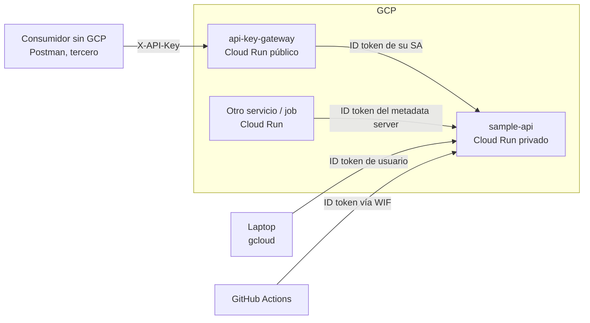
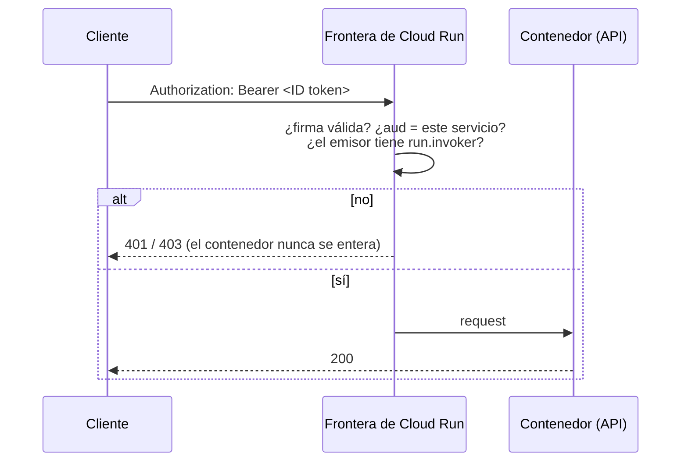

# cloudrun-private-auth

APIs **privadas en Cloud Run** sin una línea de autenticación en la API, y cómo consumirlas desde cualquier lado: laptop, otro servicio en GCP, GitHub Actions o un tercero sin cuenta de GCP.

> **La protección es el IAM de Cloud Run. El ID token es solo la credencial con la que el cliente demuestra quién es.**

El detalle del diseño está en [ARQUITECTURA.md](ARQUITECTURA.md).



| Carpeta | Qué hay |
|---|---|
| [sample-api/](sample-api/) | FastAPI con `/health` y `/whoami`. Privada |
| [client/](client/) | `identity_token.py`: `get_session(url)` y `get_token(url)` |
| [gateway/](gateway/) | Gateway público con API key que reenvía a rutas permitidas |
| [deploy/](deploy/) | Scripts `gcloud` de despliegue y permisos |
| [.github/workflows/](.github/workflows/) | `ci.yml` (llaves privadas, ruff, pytest, imágenes Docker) y `call-private-api.yml` (WIF) |

## Cómo funciona



> ⚠️ `/whoami` decodifica el JWT **sin verificar la firma**. Es aceptable solo porque Cloud Run ya lo verificó en su frontera. **No copies ese código a una API pública.**

## Puesta en marcha

Requisitos: `gcloud` autenticado y un proyecto con Cloud Run, Cloud Build, Artifact Registry, Secret Manager e IAM Credentials habilitados.

```bash
cp deploy/env.example deploy/env   # completar PROJECT_ID, REGION, GITHUB_REPO...
./deploy/deploy-sample-api.sh      # API privada (--no-allow-unauthenticated)
./deploy/verify.sh                 # API: 403 sin token, 200 con token. Gateway: 401 sin key
GATEWAY_API_KEY=<key> ./deploy/verify.sh   # además: gateway 200 con key y la API ve su SA
```

`deploy/env` está en `.gitignore`: **no hay IDs reales en el repo.**

## Cliente

```bash
pip install "git+https://github.com/<org>/cloudrun-private-auth#subdirectory=client"
```

```python
from identity_token import get_session

API = "https://sample-api-xxxx.run.app"
session = get_session(API)            # adjunta el token y lo renueva al expirar
session.get(f"{API}/whoami").json()
```

La credencial se resuelve sola, en este orden:

| # | Dónde corre | Configuración | ¿Se refresca? |
|---|---|---|---|
| 1 | Laptop | `GCP_ID_TOKEN=$(gcloud auth print-identity-token)` | No, dura ~1 h |
| 2 | Fuera de GCP (on-prem, n8n) | `GOOGLE_APPLICATION_CREDENTIALS=/ruta/llave.json` | Sí |
| 3 | Dentro de GCP (Cloud Run, GCE, Functions) | nada: metadata server | Sí |

**Errores frecuentes**

| Error | Síntoma | Qué hacer |
|---|---|---|
| Usar un access token (`print-access-token`) | `401` | Usar ID tokens. `get_token()` solo emite ID tokens |
| `aud` de otro servicio o con ruta | `401` | El cliente normaliza a `https://host`; cualquier otra cosa da `ValueError` |
| `gcloud auth print-identity-token --audiences=...` con cuenta de usuario | *Requires valid service account* | Con usuario, `print-identity-token` **sin flags** |
| Token pre-emitido caducado | `401` tras ~1 h | En procesos largos usar el camino 2 o 3 |

## Gateway con API key

Para consumidores **sin identidad en GCP** (Postman, un tercero, una herramienta no-code). **No** es para usuarios finales de una app: para eso, Identity Platform o Firebase Auth.

1. Generar una key por consumidor y guardar solo su hash:

   ```bash
   python -c "import secrets,hashlib; k=secrets.token_urlsafe(32); print('key :', k); print('hash:', hashlib.sha256(k.encode()).hexdigest())"
   printf 'testers:<hash>,partner-a:<hash>' | gcloud secrets create gateway-api-keys --data-file=-
   ```

2. Desplegar: `./deploy/deploy-gateway.sh` (crea la SA del gateway, le da `run.invoker` sobre la API y acceso al secreto).

3. Llamar:

   ```bash
   curl -H "X-API-Key: <key>" https://api-key-gateway-xxxx.run.app/whoami
   ```

4. Rotar o revocar una key: publicar una versión nueva del secreto con la lista completa y **forzar una revisión nueva**. Cada instancia lee el secreto al arrancar; sin revisión nueva, una key revocada sigue funcionando en las instancias viejas.

   ```bash
   printf 'testers:<hash-nuevo>,partner-a:<hash>' | gcloud secrets versions add gateway-api-keys --data-file=-
   gcloud run services update api-key-gateway --region <REGION> --update-env-vars "KEYS_ROTATED_AT=$(date +%s)"
   ```

| Variable | Ejemplo | Uso |
|---|---|---|
| `UPSTREAM_URL` | `https://sample-api-xxxx.run.app` | API privada (también es el audience) |
| `API_KEYS` | `testers:<sha256>,partner-a:<sha256>` | Desde Secret Manager |
| `ALLOWED_ROUTES` | `GET /health,GET /whoami` | Rutas que se pueden reenviar. Obligatoria; cada una `MÉTODO /ruta` |
| `UPSTREAM_TIMEOUT_SECONDS` | `10` | Timeout hacia la API |

| Código | Cuándo |
|---|---|
| `401` | Falta la key o es inválida |
| `404` | La ruta no está en la lista permitida |
| `413` | Body mayor de 1 MiB |
| `5xx` | La API respondió `5xx`: mismo código, cuerpo genérico |
| `502` | La API respondió `401/403`: falta `run.invoker` a la SA del gateway (un `403` propio de la API también se vería así) |
| `504` | Timeout hacia la API |

> Si la organización tiene *Domain Restricted Sharing*, `allUsers` no se puede asignar y el gateway no puede ser público. Alternativa: **API Gateway** con API keys administradas.

## CI sin llaves (Workload Identity Federation)

```bash
./deploy/setup-wif.sh   # pool, provider restringido a GITHUB_REPO en main (GITHUB_REPO_ID o gh), SA de CI y su run.invoker
```

El script imprime `WIF_PROVIDER`, `CI_SA_EMAIL` y `API_URL`: configúralas como **variables** del repo en GitHub y lanza el workflow **call-private-api** a mano. `google-github-actions/auth` cambia el token OIDC de GitHub por un ID token de la SA (no hay llave JSON en ningún secreto) y el paso de Python verifica que `/whoami` responde `200` con el email de la SA.

## Decisiones

| Decisión | Motivo |
|---|---|
| La API no tiene código de auth | Cloud Run rechaza en su frontera, antes del contenedor |
| Un solo módulo cliente para todos los entornos | El código que lo usa no distingue laptop, on-prem o GCP |
| El gateway guarda **hashes** de las keys | Si se filtra la configuración, las keys no quedan expuestas |
| `hmac.compare_digest` | Comparación en tiempo constante |
| Una key **por consumidor** | Se revoca una sin afectar a las demás; el log dice quién llamó (nunca la key) |
| **Lista permitida** de rutas | El gateway no convierte toda la API en pública |
| Se descarta el `Authorization` del cliente | Nadie puede inyectar su propio token hacia la API |
| Sin rate limiting en el gateway | Va en API Gateway o Cloud Armor, no en código; `--max-instances` (`GATEWAY_MAX_INSTANCES`, 3 por defecto) acota el costo de un abuso |
| WIF en CI | Sin llaves JSON que rotar ni filtrar |

## Cuándo usar qué

| Consumidor | Método |
|---|---|
| Servicio o job en GCP | ID token del metadata server (cliente, camino 3) |
| CI en GitHub | WIF + ID token |
| Desarrollador del equipo | `gcloud auth print-identity-token` (camino 1) |
| Tercero o tester sin GCP | Gateway con API key o API Gateway |
| Usuarios finales de una app | Identity Platform / Firebase Auth. **No** este repo |
| Apps web internas con login | IAP |

## Desarrollo

Las pruebas corren **sin GCP** (credenciales y API simuladas):

```bash
pip install -r gateway/requirements.txt -r sample-api/requirements.txt -r requirements-dev.txt
ruff check . && ruff format --check . && pytest
```

Para construir la imagen del gateway en local, el contexto es la raíz del repo: `docker build -f gateway/Dockerfile .`
